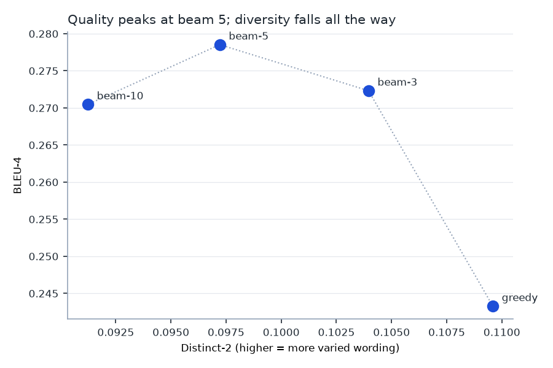
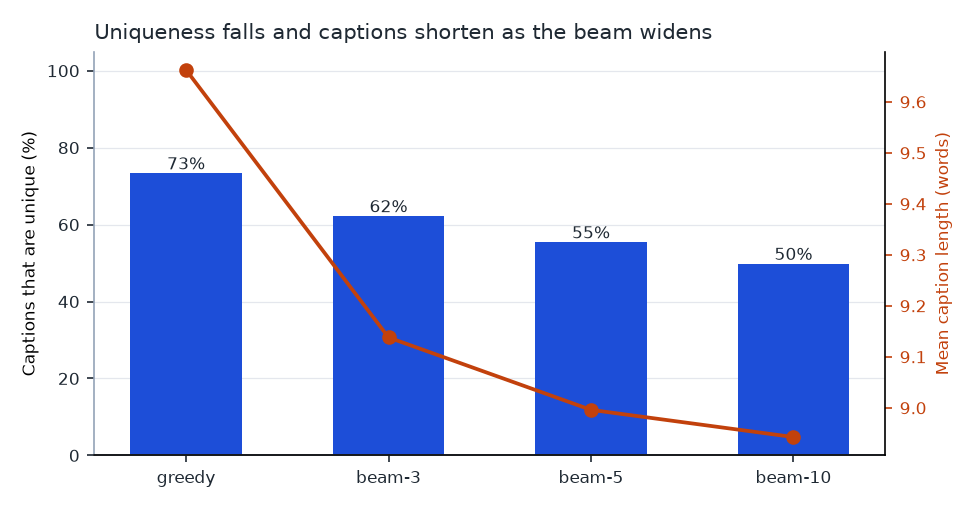

# Beam search for image captioning: how wide is too wide?

A controlled comparison of decoding strategies for a CNN–LSTM image captioner,
trained and evaluated on MS-COCO 2014.

*Tiếng Việt: [README.vi.md](README.vi.md)*

[](https://github.com/conchocon154/caption-decoding-study/actions/workflows/ci.yml)
[](LICENSE)

> Written up as a case study — the same findings with the charts, the method
> and the caveats: **[conchocon154.github.io](https://conchocon154.github.io/)**

Beam search is the default decoder for captioning models, and "use a beam of 10"
is common advice. This study measures what a wider beam actually buys, and what
it costs.

**The short answer: quality peaks at a beam of 5 and then goes down, while
caption variety falls the whole way. A beam of 10 is worse than a beam of 5 on
every axis measured, and takes twice as long.**

---

## Results

Encoder frozen throughout, decoder trained once, 1,500 held-out test images
decoded four ways. Every strategy sees identical image features, so the only
thing that varies is the search.

| Strategy | BLEU-1 | BLEU-4 | Mean length | Distinct-2 | Unique captions | Vocabulary used | ms/image |
|---|---|---|---|---|---|---|---|
| greedy | 0.678 | 0.2433 | 9.66 | **0.1096** | **73.3%** | **464** | **0.2** |
| beam-3 | **0.685** | 0.2723 | 9.14 | 0.1040 | 62.2% | 431 | 19.2 |
| **beam-5** | 0.680 | **0.2785** | 9.00 | 0.0972 | 55.4% | 422 | 31.9 |
| beam-10 | 0.671 | 0.2705 | 8.94 | 0.0912 | 49.8% | 407 | 65.9 |



### 1. Beam search beats greedy, and the gap is real

All three beams improve BLEU-4 over greedy, tested with a paired bootstrap over
5,000 resamples of the test images:

| Comparison | ΔBLEU-4 | 95% CI | p | Contender wins | Identical output |
|---|---|---|---|---|---|
| beam-3 vs greedy | +0.0236 | [+0.0148, +0.0327] | <0.0001 | 39.9% | 27.1% |
| beam-5 vs greedy | +0.0282 | [+0.0188, +0.0381] | <0.0001 | 42.9% | 21.1% |
| beam-10 vs greedy | +0.0219 | [+0.0119, +0.0321] | <0.0001 | 42.1% | 19.4% |

The win-rate column is worth pausing on. Beam-5 improves the *average* BLEU-4
by 0.028, but wins on only 42.9% of individual images — because 21.1% of its
captions are byte-identical to greedy's, and of the images where the two differ,
beam-5 wins about 54%. The headline average is carried by a subset, not by a
uniform improvement.

### 2. Past beam 5, quality goes down

| Comparison | ΔBLEU-4 | 95% CI | p | Wins | Identical output |
|---|---|---|---|---|---|
| **beam-10 vs beam-5** | **−0.0064** | **[−0.0118, −0.0012]** | **0.017** | 10.7% | 74.9% |

Widening the beam from 5 to 10 makes the captions measurably *worse*. The
interval excludes zero, so this is not noise — although note that the two agree
exactly on 74.9% of images, so the entire difference comes from a quarter of the
test set.

This is the well-known failure mode of beam search: it optimises the joint
probability of the sequence, and the highest-probability caption is not the best
caption. Wider search finds *more probable* sentences, which are the safe,
generic ones.

BLEU-1 tells the same story with a different peak — it is highest at beam-3 and
falls at 5 and 10. **Reporting a single metric at a single beam width would have
supported almost any conclusion the author wanted.**

### 3. The cost is paid in variety, and it never stops rising



Diversity declines monotonically while quality does not:

- Unique captions: **73.3% → 49.8%**. At beam-10, half the test images receive a
  caption that some other image also received.
- Vocabulary used across 1,500 captions: **464 → 407 words**, out of 5,894 available.
- Share of output taken by the ten most frequent captions: **7.3% → 11.9%**.
- Mean caption length: **9.66 → 8.94 words**. Unnormalised beam scores sum log
  probabilities, so every extra word lowers the score — the search is biased
  toward short captions by construction.

So beam-10 sits below and to the left of beam-5 in the trade-off plot: worse
BLEU *and* less variety, for double the compute. It is not a trade-off at all,
it is strictly dominated.

### 4. What this looks like in the captions

One test image, decoded four ways:

| Strategy | Caption |
|---|---|
| greedy | *a train on a track with a train on it* |
| beam-3 | *a train on a track with a train on it* |
| beam-5 | *a train traveling down tracks next to a forest* |
| beam-10 | *a train that is sitting on the tracks* |

Greedy produces a degenerate repetition. Beam-5 finds the most informative
sentence. Beam-10 retreats to something safe and contentless — fluent, probable,
and says nothing the image did not already imply.

On most images all four agree. That is the other half of the finding: for a
majority of inputs the decoding strategy makes no difference at all, and the
choice only matters on the harder tail.

---

## Recommendation

**Use a beam of 5 if caption quality is the goal, and greedy if throughput is.**

Greedy is 160× faster (0.2 ms against 31.9 ms per image) and gives up 0.028
BLEU-4 while producing noticeably more varied captions. For a service captioning
millions of images, that trade may well be worth taking; the measurement is here
so the decision can be made on numbers rather than on the folk advice to reach
for a wide beam.

**Do not use a beam of 10.** It is worse than beam-5 on quality, worse on
diversity, and twice the cost.

## Limits

- **One model, one dataset.** A CNN–LSTM captioner on COCO. Where the peak sits
  for a transformer captioner, or on another dataset, is not established here.
- **The decoder is not fully converged.** Validation loss was still falling at
  the twelfth epoch (2.323 → 2.314). Training was stopped on a fixed budget, not
  at convergence. A better-trained decoder might place the peak differently, and
  that is the first thing to check before generalising this.
- **BLEU is a weak proxy for caption quality.** It rewards n-gram overlap with
  five references. CIDEr and SPICE were designed for captioning specifically and
  would be better; they are not in the metric set here.
- **Trained on val2014, not train2014.** The 40,504-image validation set was
  split into train/val/test so the whole study runs on a laptop from a 6.5 GB
  download rather than 20 GB. The captioner is therefore weaker in absolute
  terms than one trained on the full training set — but every strategy is
  compared against the same weights, which is what the question requires.
- **1,500 test images per strategy**, not the full 4,456 test split, because
  beam search is sequential and slow.

## Method

```
COCO val2014          40,504 images, 202,654 captions (5+ per image)
   │  split BY IMAGE, never by caption          31,998 / 4,050 / 4,456
   │  vocabulary from training captions only    5,894 tokens, min count 5
   ▼
frozen ResNet-50  ──▶  2,048-d features, extracted once and cached
   │                    (40,504 images in 3m56s on Apple MPS)
   ▼
LSTM decoder      ──▶  embed 256, hidden 512, dropout 0.3, Adam 3e-4
   │                    12 epochs, best-validation checkpoint kept
   ▼
decode 1,500 test images: greedy, beam 3, beam 5, beam 10
   ▼
BLEU-1..4 · distinct-1/2 · unique-caption rate · vocabulary size · length
paired bootstrap over images, 5,000 resamples
```

Two decisions do most of the work:

**The split is by image, not by caption.** Each COCO image carries five captions
of the same scene. Splitting on captions would leave four references in training
and the fifth in test, so the model would be scored on a sentence it had nearly
memorised.

**The vocabulary is built from training captions only.** Building it over the
whole dataset lets words that appear only in test references enter the output
space, and every metric is flattered.

### An engineering result worth recording

Beam search runs **5× faster on CPU than on the GPU**: 30.7 ms against 160.8 ms
per image at beam-5. It is a sequential loop over tiny tensors, and reading each
candidate score back from the accelerator costs a synchronisation that dwarfs the
arithmetic. The first attempt at this study ran on MPS and had not finished after
two hours, with the process using four minutes of CPU time — it was almost
entirely waiting. `--decode-device cpu` is the default for that reason.

## Running it

```bash
python -m venv .venv && source .venv/bin/activate
pip install -r requirements.txt

./scripts/download.sh          # COCO val2014 + annotations, ~6.5 GB
python scripts/prepare.py      # splits, vocabulary, cached ResNet-50 features
python scripts/run_study.py    # train, decode four ways, evaluate, chart
python -m pytest tests -q
```

`--limit-test` sets how many test images each strategy decodes, `--retrain`
forces a fresh decoder, and `--decode-device` overrides the CPU default.

Neither the COCO data nor the trained weights are committed; both are rebuilt by
the scripts above.

## Tests

31 tests, no dataset required — CI runs them on constructed tensors.

The sharpest one is `test_beam_width_one_matches_greedy`: greedy decoding and
beam search are separate code paths that must produce identical output when the
beam is one, since they then describe the same algorithm. A beam implementation
that silently mis-tracks its state passes most eyeball checks and fails that one.
`test_wider_beam_never_scores_worse_than_narrower` checks the other invariant —
a wider beam explores a superset of candidates, so it cannot return a
lower-scoring sequence.

## Background

The architecture is the standard CNN encoder / LSTM decoder captioner of
[Show and Tell (Vinyals et al., 2015)](https://arxiv.org/abs/1411.4555). The
length-normalisation option in the beam scorer follows
[Wu et al., 2016](https://arxiv.org/abs/1609.08144); it is exposed but left off,
so the length bias reported above is visible rather than hidden.

This repository grew out of a 2023 university coursework project on image
captioning, which implemented both decoding strategies but never compared them.
The comparison, the metrics, the statistical testing and the code here are new.

Data: [MS-COCO 2014](https://cocodataset.org), captions licensed CC BY 4.0.
Code: MIT, see [LICENSE](LICENSE).
