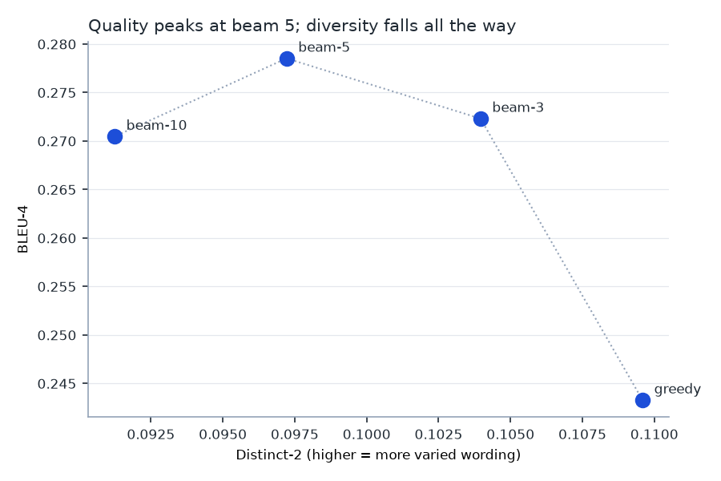
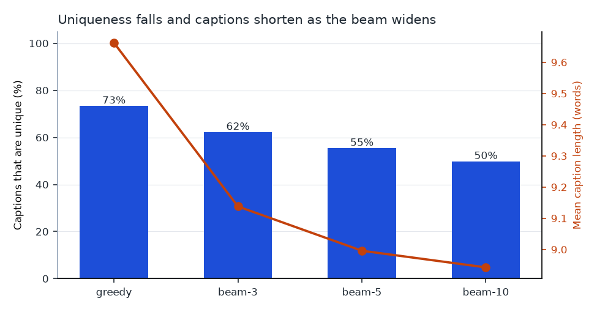

# Beam search cho chú thích ảnh: rộng bao nhiêu là quá rộng?

Nghiên cứu so sánh có kiểm soát các chiến lược giải mã cho mô hình chú thích ảnh
CNN–LSTM, huấn luyện và đánh giá trên MS-COCO 2014.

*English: [README.md](README.md)*

Beam search là cách giải mã mặc định cho mô hình chú thích ảnh, và lời khuyên
"dùng beam 10" xuất hiện khắp nơi. Nghiên cứu này đo xem beam rộng hơn thực sự
đem lại gì, và phải trả giá bằng cái gì.

**Câu trả lời ngắn gọn: chất lượng đạt đỉnh ở beam 5 rồi đi xuống, trong khi độ
đa dạng của chú thích giảm liên tục suốt. Beam 10 tệ hơn beam 5 ở mọi chỉ số đo
được, và tốn gấp đôi thời gian.**

---

## Kết quả

Encoder đóng băng toàn bộ, decoder huấn luyện một lần, 1.500 ảnh test được giải
mã theo bốn cách. Mọi chiến lược nhận đặc trưng ảnh **giống hệt nhau**, nên thứ
duy nhất thay đổi là cách tìm kiếm.

| Chiến lược | BLEU-1 | BLEU-4 | Độ dài TB | Distinct-2 | Chú thích duy nhất | Số từ dùng | ms/ảnh |
|---|---|---|---|---|---|---|---|
| greedy | 0,678 | 0,2433 | 9,66 | **0,1096** | **73,3%** | **464** | **0,2** |
| beam-3 | **0,685** | 0,2723 | 9,14 | 0,1040 | 62,2% | 431 | 19,2 |
| **beam-5** | 0,680 | **0,2785** | 9,00 | 0,0972 | 55,4% | 422 | 31,9 |
| beam-10 | 0,671 | 0,2705 | 8,94 | 0,0912 | 49,8% | 407 | 65,9 |



### 1. Beam search thắng greedy, và khoảng cách là thật

Cả ba mức beam đều cải thiện BLEU-4 so với greedy, kiểm định bằng bootstrap ghép
cặp trên 5.000 lần lấy mẫu lại tập ảnh test:

| So sánh | ΔBLEU-4 | KTC 95% | p | Tỷ lệ thắng | Đầu ra giống hệt |
|---|---|---|---|---|---|
| beam-3 vs greedy | +0,0236 | [+0,0148; +0,0327] | <0,0001 | 39,9% | 27,1% |
| beam-5 vs greedy | +0,0282 | [+0,0188; +0,0381] | <0,0001 | 42,9% | 21,1% |
| beam-10 vs greedy | +0,0219 | [+0,0119; +0,0321] | <0,0001 | 42,1% | 19,4% |

Cột tỷ lệ thắng đáng dừng lại để đọc kỹ. Beam-5 nâng BLEU-4 **trung bình** thêm
0,028 nhưng chỉ thắng ở 42,9% số ảnh riêng lẻ — vì 21,1% chú thích của nó giống
hệt greedy từng ký tự, và trong số ảnh mà hai bên khác nhau thì beam-5 thắng
khoảng 54%. Con số trung bình được kéo lên bởi một nhóm nhỏ, không phải nhờ cải
thiện đồng đều.

### 2. Vượt quá beam 5, chất lượng đi xuống

| So sánh | ΔBLEU-4 | KTC 95% | p | Thắng | Đầu ra giống hệt |
|---|---|---|---|---|---|
| **beam-10 vs beam-5** | **−0,0064** | **[−0,0118; −0,0012]** | **0,017** | 10,7% | 74,9% |

Mở rộng beam từ 5 lên 10 khiến chú thích **tệ đi** một cách đo được. Khoảng tin
cậy không chứa số 0 nên đây không phải nhiễu — dù cần lưu ý hai bên cho kết quả
trùng khớp hoàn toàn ở 74,9% số ảnh, tức toàn bộ chênh lệch đến từ một phần tư
tập test.

Đây là kiểu thất bại đã được biết đến của beam search: nó tối ưu **xác suất đồng
thời** của cả câu, mà câu có xác suất cao nhất không phải câu chú thích tốt nhất.
Tìm kiếm rộng hơn sẽ tìm ra những câu **nhiều khả năng xảy ra hơn** — tức những
câu an toàn và chung chung.

BLEU-1 kể cùng câu chuyện nhưng đỉnh ở chỗ khác: nó cao nhất ở beam-3 rồi giảm ở
5 và 10. **Nếu chỉ báo cáo một chỉ số ở một mức beam, người viết có thể chứng
minh gần như bất kỳ kết luận nào mình muốn.**

### 3. Cái giá phải trả là độ đa dạng, và nó giảm không ngừng



Độ đa dạng giảm đơn điệu trong khi chất lượng thì không:

- Chú thích duy nhất: **73,3% → 49,8%**. Ở beam-10, một nửa số ảnh test nhận
  chú thích trùng với ảnh khác.
- Số từ khác nhau dùng trong 1.500 chú thích: **464 → 407**, trên tổng 5.894 từ có sẵn.
- Tỷ lệ đầu ra chiếm bởi 10 chú thích xuất hiện nhiều nhất: **7,3% → 11,9%**.
- Độ dài chú thích trung bình: **9,66 → 8,94 từ**. Điểm beam không chuẩn hóa là
  tổng log xác suất, nên mỗi từ thêm vào đều làm điểm giảm — bản thân thuật toán
  đã thiên vị câu ngắn.

Vì vậy beam-10 nằm ở phía dưới bên trái beam-5 trong biểu đồ đánh đổi: BLEU thấp
hơn **và** ít đa dạng hơn, với chi phí gấp đôi. Đó không phải một sự đánh đổi —
nó đơn giản là bị lấn át hoàn toàn.

### 4. Nhìn vào chú thích thật

Cùng một ảnh test, giải mã bốn cách:

| Chiến lược | Chú thích |
|---|---|
| greedy | *a train on a track with a train on it* |
| beam-3 | *a train on a track with a train on it* |
| beam-5 | *a train traveling down tracks next to a forest* |
| beam-10 | *a train that is sitting on the tracks* |

Greedy sinh ra câu lặp vô nghĩa ("một đoàn tàu trên đường ray với một đoàn tàu
trên đó"). Beam-5 tìm được câu giàu thông tin nhất. Beam-10 lùi về một câu an
toàn và rỗng nội dung — trôi chảy, xác suất cao, và không nói thêm được gì mà
bức ảnh chưa ngụ ý.

Với phần lớn ảnh thì cả bốn cách cho kết quả như nhau. Đó là nửa còn lại của kết
luận: với đa số đầu vào, chọn chiến lược giải mã nào cũng không tạo khác biệt, và
lựa chọn chỉ có ý nghĩa ở phần đuôi khó.

---

## Khuyến nghị

**Dùng beam 5 nếu mục tiêu là chất lượng chú thích, dùng greedy nếu mục tiêu là
thông lượng.**

Greedy nhanh gấp 160 lần (0,2 ms so với 31,9 ms mỗi ảnh) và chỉ mất 0,028 BLEU-4,
đổi lại chú thích đa dạng hơn hẳn. Với dịch vụ phải chú thích hàng triệu ảnh, sự
đánh đổi đó hoàn toàn có thể đáng giá; phép đo ở đây tồn tại để quyết định dựa
trên số liệu thay vì theo lời khuyên truyền miệng là cứ chọn beam thật rộng.

**Đừng dùng beam 10.** Nó kém beam-5 về chất lượng, kém về đa dạng, và tốn gấp đôi.

## Giới hạn

- **Một mô hình, một bộ dữ liệu.** Mô hình CNN–LSTM trên COCO. Đỉnh nằm ở đâu với
  mô hình transformer hay bộ dữ liệu khác thì nghiên cứu này không xác lập được.
- **Decoder chưa hội tụ hoàn toàn.** Val loss vẫn đang giảm ở epoch thứ mười hai
  (2,323 → 2,314). Việc dừng là theo ngân sách cố định, không phải vì đã hội tụ.
  Một decoder huấn luyện kỹ hơn có thể đặt đỉnh ở chỗ khác, và đó là điều đầu
  tiên cần kiểm tra trước khi suy rộng kết quả này.
- **BLEU là thước đo yếu cho chất lượng chú thích.** Nó thưởng cho trùng lặp
  n-gram với năm câu tham chiếu. CIDEr và SPICE được thiết kế riêng cho bài toán
  chú thích ảnh và sẽ tốt hơn; hai chỉ số đó chưa có trong nghiên cứu này.
- **Huấn luyện trên val2014, không phải train2014.** Tập validation 40.504 ảnh
  được chia thành train/val/test để toàn bộ nghiên cứu chạy được trên laptop với
  6,5 GB tải về thay vì 20 GB. Mô hình vì thế yếu hơn về giá trị tuyệt đối so với
  mô hình huấn luyện trên tập train đầy đủ — nhưng mọi chiến lược đều so trên
  cùng một bộ trọng số, và đó mới là điều câu hỏi nghiên cứu đòi hỏi.
- **1.500 ảnh test cho mỗi chiến lược**, không phải toàn bộ 4.456 ảnh, vì beam
  search chạy tuần tự và chậm.

## Phương pháp

Hai quyết định quyết định phần lớn tính đúng đắn:

**Chia tập theo ảnh, không theo chú thích.** Mỗi ảnh COCO có năm chú thích mô tả
cùng một cảnh. Nếu chia theo chú thích thì bốn câu tham chiếu nằm ở tập huấn
luyện còn câu thứ năm nằm ở tập test — mô hình sẽ được chấm điểm trên câu mà nó
gần như đã thuộc lòng.

**Từ vựng chỉ dựng từ chú thích của tập huấn luyện.** Dựng trên toàn bộ dữ liệu
sẽ để những từ chỉ xuất hiện trong câu tham chiếu của tập test lọt vào không gian
đầu ra, và mọi chỉ số đều đẹp lên một cách giả tạo.

### Một kết quả kỹ thuật đáng ghi lại

Beam search chạy **nhanh gấp 5 lần trên CPU so với GPU**: 30,7 ms so với 160,8 ms
mỗi ảnh ở beam-5. Nó là vòng lặp tuần tự trên các tensor rất nhỏ, và mỗi lần đọc
điểm của một ứng viên từ bộ tăng tốc về đều tốn một lần đồng bộ lớn hơn nhiều so
với phép tính. Lần chạy đầu tiên dùng MPS đã không xong sau hai tiếng, trong khi
tiến trình chỉ dùng bốn phút CPU — nó gần như chỉ ngồi chờ. Đó là lý do
`--decode-device cpu` là mặc định.

## Chạy thử

```bash
python -m venv .venv && source .venv/bin/activate
pip install -r requirements.txt

./scripts/download.sh          # COCO val2014 + annotations, ~6,5 GB
python scripts/prepare.py      # chia tập, từ vựng, trích đặc trưng ResNet-50
python scripts/run_study.py    # huấn luyện, giải mã 4 cách, đánh giá, vẽ biểu đồ
python -m pytest tests -q
```

Repo không commit dữ liệu COCO lẫn trọng số đã huấn luyện; cả hai đều dựng lại
được bằng các lệnh trên.

## Kiểm thử

31 test, không cần bộ dữ liệu — CI chạy chúng trên tensor tự dựng.

Test sắc bén nhất là `test_beam_width_one_matches_greedy`: greedy và beam search
là hai nhánh code khác nhau nhưng **bắt buộc phải cho kết quả giống hệt khi beam
bằng 1**, vì khi đó chúng mô tả cùng một thuật toán. Một bản beam search quản lý
sai trạng thái vẫn qua được mọi lần kiểm tra bằng mắt nhưng sẽ trượt test này.

## Bối cảnh

Kiến trúc là mô hình chú thích ảnh CNN encoder / LSTM decoder chuẩn của
[Show and Tell (Vinyals và cộng sự, 2015)](https://arxiv.org/abs/1411.4555).
Tùy chọn chuẩn hóa độ dài trong hàm chấm điểm beam theo
[Wu và cộng sự, 2016](https://arxiv.org/abs/1609.08144); nó được để sẵn nhưng tắt
mặc định, để thiên vị độ dài nêu trên hiện ra thay vì bị che đi.

Repo này khởi nguồn từ một đồ án môn học năm 2023 về chú thích ảnh, trong đó đã
cài đặt cả hai chiến lược giải mã nhưng chưa bao giờ so sánh chúng. Phần so sánh,
các chỉ số, kiểm định thống kê và toàn bộ mã nguồn ở đây là mới.

Dữ liệu: [MS-COCO 2014](https://cocodataset.org), chú thích cấp phép CC BY 4.0.
Mã nguồn: MIT, xem [LICENSE](LICENSE).
